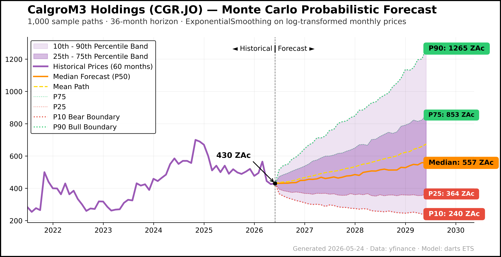

# Finance Research Automation

Excel financial models and equity research on Calgro M3 and Stefanutti Stocks, supported by Python data collection and chart generation.

By [Leabua Khomari](https://github.com/Leabua)

**Research period: May 2026.**

## Key findings

- **Calgro M3 (CGR): BUY.** Trades at a 65.9% discount to net asset value. Simulated median value of 557c (SA cents).
- **Stefanutti Stocks (SSK):** Excluding the once-off Kusile settlement, underlying revenue is declining.

## Research

| Company | Excel model | Write-up |
| :--- | :--- | :--- |
| **Calgro M3 (JSE: CGR)** | [View](research/calgro-m3/models/CGR-Full-with-Models.xlsx) · [Download](https://github.com/Leabua/Finance-Research-Automation/raw/refs/heads/main/research/calgro-m3/models/CGR-Full-with-Models.xlsx) | [May 2026 report (PDF)](research/calgro-m3/reports/Calgro-May-2026-Analysis.pdf) |
| **Stefanutti Stocks (JSE: SSK)** | [View](research/stefanutti-stocks/models/SSK-Full-Model.xlsx) · [Download](https://github.com/Leabua/Finance-Research-Automation/raw/refs/heads/main/research/stefanutti-stocks/models/SSK-Full-Model.xlsx) | [26 May 2026 report](research/stefanutti-stocks/reports/Stefanutti-Stocks-Equity-Research.md) |

Calgro covers development cash flows and valuation. SSK covers restructuring, earnings normalisation and order-book conversion.

## Selected results

### Calgro M3: Monte Carlo forecast

1,000 simulated paths over 36 months, starting at 430 ZAc (SA cents). The model applies exponential smoothing (a forecasting method that gives more weight to recent prices) to monthly log prices.

<picture>
  <source media="(prefers-color-scheme: dark)" srcset="research/calgro-m3/figures/CGR_monte_carlo_forecast_dark.png">
  
</picture>

[Forecast data (.csv)](research/calgro-m3/data/CGR_monte_carlo_forecast.csv) · [Forecast script](research/calgro-m3/scripts/generate_monte_carlo.py)

### Bankenveld: project cash-flow J-curve (initial investment followed by later cash returns)

Annual cash inflows, outflows and cumulative free cash flow across the project lifecycle.

<picture>
  <source media="(prefers-color-scheme: dark)" srcset="research/calgro-m3/figures/bankenveld_jcurve_dark.png">
  
</picture>

[Excel model](research/calgro-m3/models/CGR-Full-with-Models.xlsx) · [Chart script](research/calgro-m3/scripts/generate_bankenveld.py)

### Calgro M3: combined project cash flows

Ten-year projection combining Bankenveld, Memorial Parks and active residential developments.

<picture>
  <source media="(prefers-color-scheme: dark)" srcset="research/calgro-m3/figures/combined_jcurve_dark.png">
  
</picture>

[Memorial Parks J-curve](research/calgro-m3/figures/memorial_parks_jcurve_light.png) · [Fleurhof and South Hills J-curve](research/calgro-m3/figures/fleurhof_south_hills_jcurve_light.png) · [All Calgro figures](research/calgro-m3/figures)

## Files and methods

Each case study separates models, reports, data, figures, scripts and earlier versions. Open the downloaded models in Excel or LibreOffice to inspect formulas and assumptions.

[Calgro files](research/calgro-m3/README.md) · [SSK files](research/stefanutti-stocks/README.md) · [Earlier spreadsheet work](foundations/README.md)

[Methodology](docs/Research-Methodology.md) · [Run the scripts](docs/Running-the-Scripts.md) · [File sources](docs/File-Sources.md)
